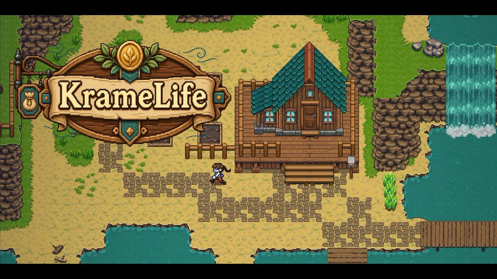

# KrameLife - 팀의 데이터와 인벤토리 UI를 하나의 플레이 흐름으로 연결한 2D 경영 RPG

   [](https://youtu.be/ArTEC_peleQ)

> 본 저장소는 4인 팀 프로젝트 `ProjectTownLife`가 **KrameLife(카르메 라이프)**로 완성된 뒤, 제가 담당한 코드와 협업 문서를 선별한 **코드 열람 저장소**입니다. 외부 에셋, 씬, 프리팹, 빌드 파일과 팀원 담당 코드는 포함하지 않으므로 Unity에서 그대로 실행되지 않습니다. 플레이는 아래 영상으로 확인해 주세요.

[](https://youtu.be/ArTEC_peleQ)

▶︎ [플레이 영상](https://youtu.be/ArTEC_peleQ) · 📄 [기술 문서 인덱스](Docs/README.md) · 📐 [아키텍처 개요](ARCHITECTURE.md) · 👤 [GitHub 프로필](https://github.com/Femur-0607)

## 프로젝트 정보

| 항목 | 내용 |
| --- | --- |
| 장르 | 2D 탑다운 상점 경영 RPG |
| 개발 기간 | 2026.06.08 – 07.17 (6주), 후속 수정 ~07.20 |
| 개발 형태 | 4인 팀 프로젝트 |
| 개발 환경 | Unity 6000.3.17f1 (6.3 LTS), C# |
| 담당 | 공통 데이터·인벤토리·UI 통합, 저장·씬 흐름, 프로젝트 관리 |
| 주요 기술 | CSV → ScriptableObject, 슬롯 인벤토리, 이벤트 채널, Addressables, Save/Load, Additive Scene Flow |
| 상태 | 완료 (팀 프로젝트 종료) |

재료를 모아 아이템을 만들고 가판대에서 파는 생활형 경영 RPG입니다. 저는 팀원 기능이 같은 데이터·저장·화면 흐름 위에서 동작하도록 공통 토대를 만들고, 인벤토리와 UI를 그 위에 연결했습니다.

## 담당 범위 — 팀 기반과 내 변경

| 구분 | 내용 |
| --- | --- |
| 팀원이 먼저 만든 것 | ID별 수량 관리 인벤토리 골격, 인벤토리의 저장 참여 구조, 오브젝트 풀 매니저, 제작·판매 등 개별 기능 |
| 내가 변경·추가한 것 | 수량 인벤토리를 슬롯 목록으로 확장(이동·해금·위치 저장), 일반 슬롯·퀵슬롯 UI와 입력, CSV 검증 도구와 SO 갱신, 공통 획득 서비스, 획득 로그, Save/Load·GameContext·Scene Flow 공통 토대 |

## 핵심 구현

### 1. 수량 인벤토리를 위치가 있는 슬롯으로 확장

**문제.** 팀의 초기 인벤토리는 `Dictionary<string, int>`로 아이템 ID별 수량만 관리했습니다. 화면에서 아이템을 옮기고 빈칸을 유지하고 슬롯을 해금하려면 "몇 개"뿐 아니라 "어느 칸에"가 필요했습니다.

**선택.** 모델을 `List<ItemStack> slots`로 바꾸고 `MoveSlot`, `UnlockSlots`, 빈 슬롯 탐색을 추가했습니다. 저장은 빈칸을 포함한 슬롯 순서와 해금 수를 그대로 기록합니다. 상태가 바뀌면 `InventoryChanged` 이벤트를 발행하고, 일반 슬롯 패널과 퀵슬롯이 이를 구독해 화면을 갱신합니다. 퀵슬롯은 인벤토리 앞쪽 슬롯을 함께 보여 주며 숫자키·휠로 전환합니다.

**결과.** 빈칸을 포함한 슬롯 순서로 같은 배치를 복원하도록 했고, UI의 드래그는 모델의 `MoveSlot`을 호출하도록 연결했습니다. Dictionary 조회가 느려서 바꾼 것이 아니라 위치·빈칸·순서라는 요구 때문에 바꾼 변경입니다.

- [ItemInventoryManager.cs](https://github.com/Femur-0607/KrameLife-Portfolio/blob/6d15afbee594f63f3d60da8e753e182d81e91550/Assets/_Project/01.Scripts/02.Gameplay/Inventory/ItemInventoryManager.cs) · [ItemStack.cs](https://github.com/Femur-0607/KrameLife-Portfolio/blob/6d15afbee594f63f3d60da8e753e182d81e91550/Assets/_Project/01.Scripts/01.Core/Item/ItemStack.cs) · [InventorySave.cs](https://github.com/Femur-0607/KrameLife-Portfolio/blob/6d15afbee594f63f3d60da8e753e182d81e91550/Assets/_Project/01.Scripts/01.Core/Save/InventorySave.cs) · [InventoryPanelController.cs](https://github.com/Femur-0607/KrameLife-Portfolio/blob/6d15afbee594f63f3d60da8e753e182d81e91550/Assets/_Project/01.Scripts/05.UI/Inventory/InventoryPanelController.cs)

### 2. CSV를 검증한 뒤 기존 ScriptableObject를 갱신

**문제.** 아이템 이름·가격·스택·아이콘 주소가 코드, Inspector, 문서, SO에 흩어져 팀원마다 다른 값을 보는 일이 생겼습니다.

**선택.** Google Sheets CSV를 원본으로 두고, `ItemSheetValidator`가 행의 필수값·ID 형식·중복 ID·가격·스택 범위를 검사해 오류를 목록으로 모으도록 했습니다. 오류가 있으면 SO 반영 전에 중단하고, 통과하면 `ItemSheetImportWindow`가 생성 루트 안에서 같은 ID의 SO를 찾아 `SerializedObject`로 갱신하도록 했습니다. 기존 에셋이 없으면 새로 생성하며, SO는 `GameDatabase`에 등록해 런타임에서 ID로 조회합니다.

**결과.** 데이터는 CSV에서 검증하고, 런타임은 등록된 SO와 ID로 조회하도록 했습니다. 상점·제작·인벤토리가 같은 데이터로 동작합니다.

- [ItemSheetValidator.cs](https://github.com/Femur-0607/KrameLife-Portfolio/blob/6d15afbee594f63f3d60da8e753e182d81e91550/Assets/_Project/01.Scripts/01.Core/Item/ItemSheetValidator.cs) · [ItemSheetImportWindow.cs](https://github.com/Femur-0607/KrameLife-Portfolio/blob/6d15afbee594f63f3d60da8e753e182d81e91550/Assets/_Project/01.Scripts/01.Core/Item/Editor/ItemSheetImportWindow.cs) · [GameDatabase.cs](https://github.com/Femur-0607/KrameLife-Portfolio/blob/6d15afbee594f63f3d60da8e753e182d81e91550/Assets/_Project/01.Scripts/01.Core/Databases/GameDatabase.cs) · [RecipeSheetValidator.cs](https://github.com/Femur-0607/KrameLife-Portfolio/blob/2672a390fdcb76c242897e720fa625d52e493496/Assets/_Project/01.Scripts/01.Core/ScriptableObjects/RecipeSheetValidator.cs) (레시피 필드를 별도로 검증)

### 3. 획득 로그의 표시 한도 처리와 재사용 수명 정리

**문제.** 아이템 획득 로그가 표시 한도를 넘으면 자식 수가 한도보다 클 동안 `Destroy`를 반복하는 코드였습니다. Unity의 `Destroy`는 호출 즉시 제거하지 않으므로 같은 반복 안에서 자식 수가 줄어든다는 가정이 성립하지 않습니다.

**선택.** 초과 개수를 먼저 계산해 정해진 횟수만 처리하도록 바꿨습니다. 팀의 오브젝트 풀을 로그 항목에 연결해 반환하고, 반환 전에 이전 페이드 코루틴을 `Dictionary<GameObject, Coroutine>`으로 찾아 정리합니다. 풀을 쓰지 않는 경로는 부모에서 분리한 뒤 파괴합니다.

**결과.** 초과 항목은 정해진 횟수만 반환하고, 조기 반환 때 해당 페이드 코루틴을 중지·제거하도록 했습니다. 풀 매니저 자체는 팀원 구현이며 제 변경은 로그의 반환·코루틴·재사용 상태 처리입니다.

- [AcquisitionLogController.cs](https://github.com/Femur-0607/KrameLife-Portfolio/blob/6d15afbee594f63f3d60da8e753e182d81e91550/Assets/_Project/01.Scripts/05.UI/AcquisitionLogController.cs) · [AcquisitionLogEntryView.cs](https://github.com/Femur-0607/KrameLife-Portfolio/blob/2672a390fdcb76c242897e720fa625d52e493496/Assets/_Project/01.Scripts/05.UI/AcquisitionLogEntryView.cs) · [ItemAcquisitionService.cs](https://github.com/Femur-0607/KrameLife-Portfolio/blob/6d15afbee594f63f3d60da8e753e182d81e91550/Assets/_Project/01.Scripts/02.Gameplay/Inventory/ItemAcquisitionService.cs)

## 그 밖에 담당한 공통 토대

- **모듈 단위 Save/Load:** 각 모듈이 `ISaveParticipant`로 `Capture`/`Restore`를 구현하고 `SaveManager`가 순회합니다. → [ISaveParticipant.cs](https://github.com/Femur-0607/KrameLife-Portfolio/blob/2672a390fdcb76c242897e720fa625d52e493496/Assets/_Project/01.Scripts/01.Core/Interfaces/ISaveParticipant.cs) · [SaveManager.cs](https://github.com/Femur-0607/KrameLife-Portfolio/blob/6d15afbee594f63f3d60da8e753e182d81e91550/Assets/_Project/01.Scripts/01.Core/Save/SaveManager.cs) · [문서](Docs/save-scene-flow.md)
- **데이터 기반 대화·퀘스트:** 8개 시트 탭을 검증해 `DialogueDatabaseSO`로 만들고 `DialogueRunner`가 조건·효과를 실행합니다. → [DialogueRunner.cs](https://github.com/Femur-0607/KrameLife-Portfolio/blob/6d15afbee594f63f3d60da8e753e182d81e91550/Assets/_Project/01.Scripts/07.Systems/Dialogue/DialogueRunner.cs) · [QuestManager.cs](https://github.com/Femur-0607/KrameLife-Portfolio/blob/6d15afbee594f63f3d60da8e753e182d81e91550/Assets/_Project/01.Scripts/07.Systems/Quests/QuestManager.cs)
- **GameContext와 Additive Scene Flow:** 공통 서비스 접근 지점과 Persistent 씬 유지, enum 기반 Scene/Spawn ID. → [GameContext.cs](https://github.com/Femur-0607/KrameLife-Portfolio/blob/6d15afbee594f63f3d60da8e753e182d81e91550/Assets/_Project/01.Scripts/01.Core/SceneFlow/GameContext.cs) · [SceneFlowManager.cs](https://github.com/Femur-0607/KrameLife-Portfolio/blob/6d15afbee594f63f3d60da8e753e182d81e91550/Assets/_Project/01.Scripts/01.Core/SceneFlow/Persistent/SceneFlowManager.cs)
- **Addressables 아이콘 로드:** 주소별 캐시와 요청 버전 비교로 늦게 도착한 결과가 현재 슬롯을 덮어쓰지 않게 했습니다. → [ItemIconLoader.cs](https://github.com/Femur-0607/KrameLife-Portfolio/blob/6d15afbee594f63f3d60da8e753e182d81e91550/Assets/_Project/01.Scripts/05.UI/Inventory/ItemIconLoader.cs)

## 협업 방식

기능 범위·공통 ID·완료 기준을 먼저 문서로 맞추고, 완료 판단은 개별 동작이 아니라 메인 플레이 흐름에서의 연결로 했습니다. 규칙과 작업 보드 운영은 [팀 개발 규칙](Docs/team-rules.md)에 있습니다.

## 저장소 구조

```text
Assets/_Project/01.Scripts/   # 01.Core(데이터·저장·씬) · 02.Gameplay(인벤토리·획득) · 05.UI · 07.Systems(대화·퀘스트·도감)
Docs/                          # 기술 문서 인덱스, 데이터 파이프라인, 저장·씬 흐름, 팀 규칙
ARCHITECTURE.md                # 시스템 책임과 의존 방향
```

## 공개 범위와 확인 방법

- 이 저장소는 **코드 열람용**입니다. 유료·외부 에셋, 씬, 프리팹, 팀원 담당 코드가 없어 Unity에서 그대로 실행되지 않습니다.
- 플레이 결과는 [영상](https://youtu.be/ArTEC_peleQ)으로 확인해 주세요.
- 원본에서 제 담당 파일을 선별해 옮겼습니다. 인벤토리·패널·아이템 검증기·임포터·DB는 `main`(`a2ec507`), 획득 로그·레시피 검증기는 `dev`(`1e73d25`) 기준입니다. 코드 링크는 커밋 `6d15afb`·`2672a39`에 고정돼 있어 이후 변경과 무관하게 같은 내용을 가리킵니다.

© 2026 Yang Ji-seop. Portfolio use only.
